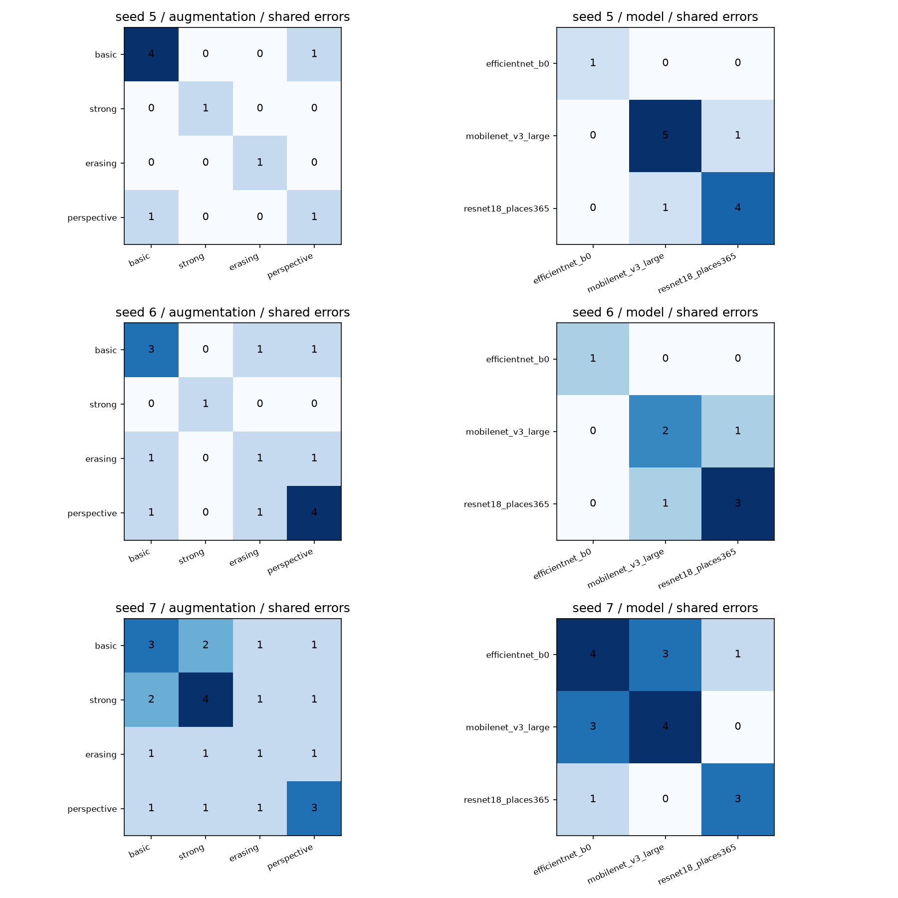

# 실험 000 분석 결과

검증 분할 seed 5, 검증 436장, 학습 seed [5, 6, 7], 완료 18회.

같은 검증셋의 세 학습 seed를 비교했다. 표준편차는 해당 조건의 실행 변동이며 새 데이터의 오차범위를 뜻하지 않는다.

## 조건별 요약

| 모델 | 증강 | 평균 오답 수 | 평균 Log Loss | 표본 표준편차 |
|---|---|---:|---:|---:|
| efficientnet_b0 | basic | 3.33 | 0.023980 | 0.007598 |
| efficientnet_b0 | strong | 2.00 | 0.013746 | 0.004314 |
| efficientnet_b0 | erasing | 1.00 | 0.009033 | 0.001549 |
| efficientnet_b0 | perspective | 2.67 | 0.017038 | 0.005247 |
| mobilenet_v3_large | strong | 3.67 | 0.031028 | 0.018636 |
| resnet18_places365 | strong | 3.33 | 0.025488 | 0.006616 |

## 같은 seed의 쌍별 오답

| 비교 | A | B | A 오답 | B 오답 | 공통 | A만 오답 | B만 오답 |
|---|---|---|---:|---:|---:|---:|---:|
| augmentation | efficientnet_b0_basic_seed5 | efficientnet_b0_strong_seed5 | 4 | 1 | 0 | 4 | 1 |
| augmentation | efficientnet_b0_basic_seed5 | efficientnet_b0_erasing_seed5 | 4 | 1 | 0 | 4 | 1 |
| augmentation | efficientnet_b0_basic_seed5 | efficientnet_b0_perspective_seed5 | 4 | 1 | 1 | 3 | 0 |
| augmentation | efficientnet_b0_strong_seed5 | efficientnet_b0_erasing_seed5 | 1 | 1 | 0 | 1 | 1 |
| augmentation | efficientnet_b0_strong_seed5 | efficientnet_b0_perspective_seed5 | 1 | 1 | 0 | 1 | 1 |
| augmentation | efficientnet_b0_erasing_seed5 | efficientnet_b0_perspective_seed5 | 1 | 1 | 0 | 1 | 1 |
| model | efficientnet_b0_strong_seed5 | mobilenet_v3_large_strong_seed5 | 1 | 5 | 0 | 1 | 5 |
| model | efficientnet_b0_strong_seed5 | resnet18_places365_strong_seed5 | 1 | 4 | 0 | 1 | 4 |
| model | mobilenet_v3_large_strong_seed5 | resnet18_places365_strong_seed5 | 5 | 4 | 1 | 4 | 3 |
| augmentation | efficientnet_b0_basic_seed6 | efficientnet_b0_strong_seed6 | 3 | 1 | 0 | 3 | 1 |
| augmentation | efficientnet_b0_basic_seed6 | efficientnet_b0_erasing_seed6 | 3 | 1 | 1 | 2 | 0 |
| augmentation | efficientnet_b0_basic_seed6 | efficientnet_b0_perspective_seed6 | 3 | 4 | 1 | 2 | 3 |
| augmentation | efficientnet_b0_strong_seed6 | efficientnet_b0_erasing_seed6 | 1 | 1 | 0 | 1 | 1 |
| augmentation | efficientnet_b0_strong_seed6 | efficientnet_b0_perspective_seed6 | 1 | 4 | 0 | 1 | 4 |
| augmentation | efficientnet_b0_erasing_seed6 | efficientnet_b0_perspective_seed6 | 1 | 4 | 1 | 0 | 3 |
| model | efficientnet_b0_strong_seed6 | mobilenet_v3_large_strong_seed6 | 1 | 2 | 0 | 1 | 2 |
| model | efficientnet_b0_strong_seed6 | resnet18_places365_strong_seed6 | 1 | 3 | 0 | 1 | 3 |
| model | mobilenet_v3_large_strong_seed6 | resnet18_places365_strong_seed6 | 2 | 3 | 1 | 1 | 2 |
| augmentation | efficientnet_b0_basic_seed7 | efficientnet_b0_strong_seed7 | 3 | 4 | 2 | 1 | 2 |
| augmentation | efficientnet_b0_basic_seed7 | efficientnet_b0_erasing_seed7 | 3 | 1 | 1 | 2 | 0 |
| augmentation | efficientnet_b0_basic_seed7 | efficientnet_b0_perspective_seed7 | 3 | 3 | 1 | 2 | 2 |
| augmentation | efficientnet_b0_strong_seed7 | efficientnet_b0_erasing_seed7 | 4 | 1 | 1 | 3 | 0 |
| augmentation | efficientnet_b0_strong_seed7 | efficientnet_b0_perspective_seed7 | 4 | 3 | 1 | 3 | 2 |
| augmentation | efficientnet_b0_erasing_seed7 | efficientnet_b0_perspective_seed7 | 1 | 3 | 1 | 0 | 2 |
| model | efficientnet_b0_strong_seed7 | mobilenet_v3_large_strong_seed7 | 4 | 4 | 3 | 1 | 1 |
| model | efficientnet_b0_strong_seed7 | resnet18_places365_strong_seed7 | 4 | 3 | 1 | 3 | 2 |
| model | mobilenet_v3_large_strong_seed7 | resnet18_places365_strong_seed7 | 4 | 3 | 0 | 4 | 3 |

## 전원 일치 오답과 앙상블

| 비교 | seed | 전원 일치 오답 | 앙상블 오답 | Log Loss |
|---|---:|---:|---:|---:|
| augmentation | 5 | 0 | 1 | 0.003423 |
| model | 5 | 0 | 1 | 0.008710 |
| augmentation | 6 | 0 | 1 | 0.008323 |
| model | 6 | 0 | 1 | 0.007304 |
| augmentation | 7 | 1 | 2 | 0.022249 |
| model | 7 | 0 | 4 | 0.014323 |

공통 오답이 0이어도 한쪽 모델의 오답 자체가 0이면 다양성에 대한 근거가 제한된다.

오답 확신 변화와 같은 조건의 seed별 비교는 [pairwise.csv](pairwise.csv)에 기록했다.

